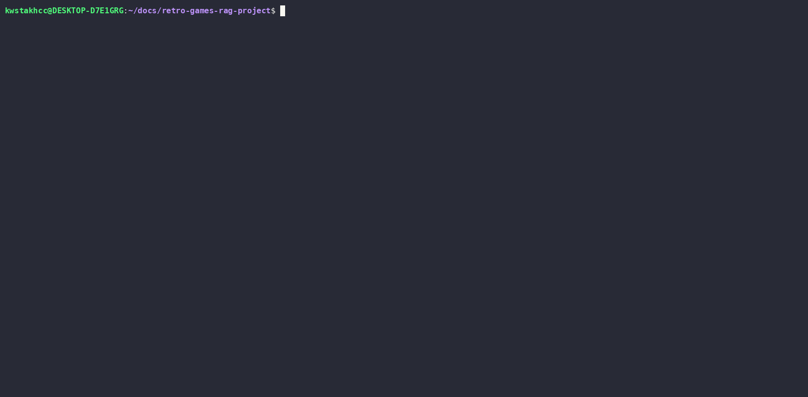

# Retrieval Augmented Generation (RAG) Practice Project
A **Retrieval-Augmented Generation (RAG) system** built in **Python**. It loads `.csv` files with information about video games released on retro systems into a list of dictionaries, derives a corpus with relevant game metadata, embeds them with a `TfidfVectorizer` or a `SentenceTransformer` object, answers user queries by retrieving the most relevant chunks and passes them as context to an LLM along with specific instructions, via OpenRouter.

## Interactive Session



## Project Structure
```
retro-games-rag/
│
├── data/                      # Data storage
│   ├── game-info/             # Raw OpenGameDB CSVs 
│   └── knowledge_base.json    # Processed JSON knowledge base
| 
├── docs/                      
│   └── demo.gif               # Interactive session gif
│
├── models/                    # Saved model artifacts (ignored by git)
│   ├── tfidf_model.joblib
│   ├── tfidf_embeddings.joblib
│   ├── minilm_model/          # Directory containing Hugging Face model weights
│   └── minilm_embeddings.npy
│
├── src/                       # Source code package
│   ├── __init__.py            # Makes src a Python package
│   ├── config.py              # Directory paths and global constants
│   ├── utils.py               # Helper scripts  
│   ├── data_loader.py         # CSV parsing, cleaning, and JSON building
│   ├── embed.py               # Model loading, fitting, and embedding logic
│   ├── retrieve.py            # Cosine similarity and top-k retrieval
│   ├── system_prompt.py       # Assembles instructions + context
│   └── generate.py            # OpenRouter API calls and error handling
│
├── cli_retro_rag.py           # CLI app
├── .gitignore                 # Files to ignore (venv, models)
├── requirements.txt           # Project dependencies
└── README.md                  # Project documentation
```


## Module Overview

### Core Modules

| Script | What it does |
|---|---|
| `cli_retro_rag.py` |  Runs the interactive terminal loop; reads a query, prints a loading message, and displays the answer.  |
| `src/data_loader.py` | Reads all `.csv` files from the `data/game-info` folder, parses/cleans extracted information into a list of dictionaries - knowledge base - and loads game descriptions to a list of strings so that a corpus is formed. |
| `src/embed.py` | Builds/Loads models to encode the aforementioned corpus and calculates/loads the associated embeddings. The models/embeddings are saved in the `models/` directory. |
| `src/retrieve.py` | Computes cosine similarity between the query and corpus embeddings; returns the top knowledge base matches specified by the parameter `k`. |
| `src/system_prompt.py` | Assembles instructions + context into a system prompt for the LLM. |
| `src/generate.py` | Assembles data payload with system prompt and user query and makes POST request to OpenRouter API so the LLM generates an answer. If an answer is, indeed, generated it is formatted and returned to the user. Otherwise, an exception is raised. |

### Helper Modules

| Script | What it does |
|---|---|
| `src/utils.py` | Prints banner when the main loop starts, prints waiting messages and formats LLM responses. |
| `src/config.py` | Adds OS environment variables, directory paths, API settings, LLM instructions, RAG system messages and chat history parameters.|

## Prerequisites
- **Python 3.14.4+**
- **An OpenRouter API key** — get one at [openrouter.ai/keys](https://openrouter.ai/keys)

## Setup

### Optional: Hugging Face Token

The project runs without a token, but you may see a warning about
unauthenticated requests to the Hugging Face Hub if you run the script with the `--model` flag set to `"minilm"` - further details can be found in the [Usage](#usage) section.

Setting `HF_TOKEN` enables higher rate limits and faster model downloads. 

#### Linux/Bash

```bash
# Clone the repo
git clone <repo-url>
cd retro-games-rag-project

# Create a virtual environment
python3 -m venv venv
source venv/bin/activate

# Install dependencies
pip install -r requirements.txt

# Set your API key
export OPENROUTER_API_KEY='your_api_key_here'

# Optional: Set your Hugging Face Access Token
export HF_TOKEN='your_token_here'
```

#### Windows/Powershell

```bash
# Clone the repo
git clone <repo-url>
cd retro-games-rag-project

# Create a virtual environment
python -m venv venv
.\venv\Scripts\Activate.ps1

# Install dependencies
pip install -r requirements.txt

# Set your API key
$env:OPENROUTER_API_KEY = "your_api_key_here"

# Optional: Set your Hugging Face Access Token
$env:HF_TOKEN = "your_token_here"
```

## Usage

By default the script uses a `TfidfVectorizer` object for embedding and retrieves the top 200 most relevant chunks using the cosine similarity measure.

```bash
# Make sure you are inside the project directory,
# your virtual environment is activated and the OpenRouter API key is set
python3 cli_retro_rag.py
```

You can also specify the model to be used for embedding
with the `--model` flag and the number of top chunks retrieved with the `--num_top_chunks` flag as shown in the example below.

```bash
# Make sure you are inside the project directory,
# your virtual environment is activated and the OpenRouter API key is set
python3 cli_retro_rag.py --model "minilm" --num_top_chunks 700
```
Lastly, note that any string other than `"tfidf"` and `"minilm"` raises a value error.

## Notable Features
* **Retro-game-style waiting messages:** Getting an answer back from the LLM takes a few seconds.
To compensate for this,
custom retro-game-style waiting messages defined in `config.py` are printed upon query submission (problem solved yay!).

* **Chat History:** Persists conversation context across turns so that follow-up questions can be handled.

## Acknowledgements & License

This project uses video game metadata and descriptions from **[opengamedb](https://github.com/karlforshaw/opengamedb)** by [karlforshaw](https://github.com/karlforshaw), which is licensed under the MIT License.

* **What was used:** Game titles, platform metadata, text descriptions and cover art urls from the repository's CSV datasets.
* **Modifications:** Filtered/cleaned specific columns.
* **License:**       The MIT License for this dataset is included in [`LICENSE.md`](./data/data-license/LICENSE.md).

> All video game titles, descriptions, and cover art belong to their respective publishers and copyright holders, and are used here strictly for educational and non-commercial portfolio purposes.

## License
The source code is released under the [MIT License](LICENSE.md).
